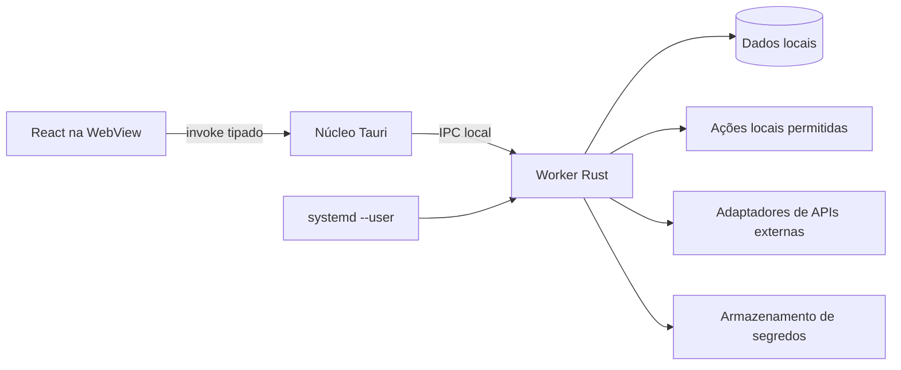

# Backend local e integrações — gns-hub

Status: arquitetura inicial para Linux Mint · 2026-10-12

**Estado atual:** a primeira versão executável usa `apps/backend/server.py` e `apps/backend/audio.py`: servidor HTTP restrito a `127.0.0.1`, token de sessão para mutações, preferências locais e `pactl` para controlar áudio. O worker Rust e o IPC por socket Unix abaixo descrevem uma evolução planejada, ainda não implementada.

## 1. Responsabilidade e processos

O backend do hub terá um **worker local em Rust** que continua ativo enquanto a janela estiver fechada. Ele será um processo do usuário, gerenciado por `systemd --user` na primeira distribuição Linux. A interface Tauri será outro processo: abre a janela, apresenta o estado e envia pedidos tipados ao worker. Na primeira abertura, o aplicativo pode iniciar o serviço; quando a janela fecha, o worker permanece. Início automático no login é uma escolha separada. Quando o usuário encerra a sessão do Linux, o worker pode parar; execução após logout ou durante o boot ainda não é requisito.

Não haverá servidor Node nem porta HTTP local na primeira versão. A comunicação entre o núcleo nativo do Tauri e o worker será por **Unix domain socket** no diretório de execução do usuário (`XDG_RUNTIME_DIR`). O worker será dono do socket e do banco de dados. O frontend JavaScript não receberá um caminho para executar comandos arbitrários nem acesso direto ao banco.

Se futuramente houver interface no navegador ou acesso remoto, um gateway específico poderá usar o mesmo núcleo de domínio. Isso exigirá autenticação e revisão de exposição de comandos; não faz parte da primeira versão.

## 2. Fronteiras internas

| Camada | Responsabilidade | Não deve fazer |
| --- | --- | --- |
| UI React | Renderizar, coletar intenção, mostrar progresso e erros | Executar shell, guardar credenciais ou acessar banco diretamente |
| Núcleo Tauri | Ponte tipada para o worker, janela e capacidades nativas estritamente necessárias | Concentrar automações que precisam sobreviver à janela |
| Worker | Validar pedidos, agendar tarefas, executar ações, chamar APIs e persistir estado | Confiar em parâmetros vindos da UI sem validação |
| Domínio compartilhado | Tipos e regras de ações, atalhos, tarefas e erros | Depender de React, WebView ou `systemd` |
| Adaptadores | Encapsular detalhes de Linux, armazenamento, rede e segredos | Espalhar comandos e formatos externos pelas regras de domínio |

O registro de destinos e ações mencionado em `System Design.md` possui duas faces: **metadados seguros** para navegação e busca na UI; **definição executável** validada e guardada pelo worker. A UI envia um ID e parâmetros permitidos. O worker recupera sua própria definição, verifica tipo, escopo e confirmação, e só então executa.

## 3. Contrato de ação

Toda ação deverá declarar identificador estável, rótulo, categoria, parâmetros tipados, modo de execução, nível de risco, necessidade de confirmação, disponibilidade e origem. O pedido da UI inclui `action_id`, parâmetros, identificador de solicitação e versão do protocolo. A resposta inclui resultado ou erro estruturado; tarefas longas podem informar progresso e aceitar cancelamento.

Erros mínimos: `not_found`, `invalid_input`, `not_allowed`, `needs_confirmation`, `unavailable`, `timeout`, `external_failure` e `internal_error`. A UI traduz esses estados para mensagens úteis. O worker registra eventos de execução com horário, ação, duração e resultado, sem valores de credenciais nem conteúdo sensível desnecessário.

## 4. Ações locais

- **Primeira ação definida:** seleção de saída de áudio conforme [Audio Output.md](Audio%20Output.md). Outras ações ainda dependem de definição; nenhum comando genérico é autorizado só por existir uma paleta de comandos.
- URLs e arquivos podem usar o mecanismo de abertura do sistema com escopos explícitos. Aplicativos e scripts, quando necessários, devem ser cadastrados por caminho/identificador conhecido e argumentos permitidos.
- Nunca transformar texto digitado na busca em `sh -c` ou comando de shell. Não fornecer um endpoint genérico `execute(command: string)`.
- Validar caminhos e argumentos no worker, limitar tempo de execução e tamanho de saída, evitar expansão de shell, informar progresso e permitir cancelamento quando viável.
- Mudanças sensíveis no sistema devem ter confirmação, tratamento de falha e política de privilégio próprios. O worker roda com privilégios normais do usuário; elevação não é comportamento padrão.

## 5. Integrações por API

Cada integração terá um adaptador com configuração, endpoints/hosts permitidos, autenticação, timeout, tratamento de indisponibilidade e conversão de dados para tipos internos. Chamadas HTTP e credenciais ficam no worker, não no JavaScript da WebView. Só repetir automaticamente operações idempotentes; aplicar limites de frequência e backoff quando a API exigir. A falha de uma integração não deve derrubar as demais funções do hub.

O armazenamento de segredos será acessado por uma interface `SecretStore`. Para o Linux Mint, a implementação deverá usar um serviço seguro do usuário disponível na máquina; a escolha e o comportamento de desbloqueio serão validados quando a primeira integração com credenciais for definida. O banco, logs, arquivos versionados e IPC não guardam tokens em claro. A execução em segundo plano exige testar acesso a credenciais após login e com a janela fechada.

## 6. Dados e configuração

O worker será o único escritor do estado persistente. **SQLite embutido** é o alvo para atalhos, grupos, definições de tarefa, integrações configuradas e histórico operacional limitado; não requer um servidor de banco separado. Preferências puramente visuais podem ficar em configuração local, desde que não criem uma segunda fonte de verdade para ações. Esquema e migrações devem ser versionados desde a primeira tabela. Dados de usuário e configuração usam os diretórios XDG apropriados; arquivos temporários e socket usam `XDG_RUNTIME_DIR`.

Definir backup/exportação antes de confiar dados importantes ao hub. O formato exportado não pode incluir segredos. O histórico de execução precisa de retenção e limpeza para não crescer indefinidamente.

## 7. Automação em segundo plano

O worker pode ser iniciado na primeira abertura do aplicativo e executa tarefas habilitadas independentemente da janela. Início automático no login só será habilitado se o responsável escolher essa opção. Cada tarefa deve declarar gatilho, ação, política de repetição, timeout, tratamento de falha e último resultado. Evitar polling contínuo quando houver eventos ou intervalos maiores suficientes. Tarefas de longa duração devem ser canceláveis quando possível e não bloquear a resposta ao aplicativo.

Na primeira entrega, a infraestrutura do worker pode existir com uma tarefa de teste inofensiva; nenhuma automação real será inventada. A implementação de agendamento entra quando houver um caso concreto. A UI mostra se o worker está conectado, qual a última execução e como pausar uma tarefa.

## 8. Segurança do IPC e operação

- Socket criado em diretório privado do usuário, sem exposição TCP. Verificar proprietário/permissões e aplicar controle de acesso por usuário no lado servidor.
- Protocolo versionado, mensagens com tamanho máximo, validação de campos e respostas com erro explícito.
- Capacidades Tauri mínimas; comandos nativos personalizados também validam escopo no próprio Rust.
- Logs locais rotativos, com identificação de falhas suficiente para diagnóstico e redação de credenciais.
- Inicialização, atualização e desligamento devem preservar integridade do banco; uma falha do worker aparece claramente na UI e permite recuperação.

## 9. Portabilidade posterior

O domínio e os adaptadores são separados. Em Windows/macOS, será necessário trocar gerenciador de serviço, IPC, abertura de aplicativos e armazenamento de segredos. A primeira entrega é para Linux Mint; não declarar suporte multiplataforma antes de testar cada plataforma.

## Fontes de implementação

- [Tauri: chamadas do frontend para Rust](https://v2.tauri.app/develop/calling-rust/)
- [Tauri: capacidades e limites de segurança](https://tauri.app/security/capabilities/)
- [Tauri: abertura de URLs e arquivos](https://tauri.app/plugin/opener/)
- [Tauri: shell e escopos](https://tauri.app/plugin/shell/)
- [Tokio: UnixListener](https://docs.rs/tokio/latest/tokio/net/struct.UnixListener.html)
- [systemd: serviços do usuário e sessão](https://www.freedesktop.org/software/systemd/man/251/pam_systemd.html)
