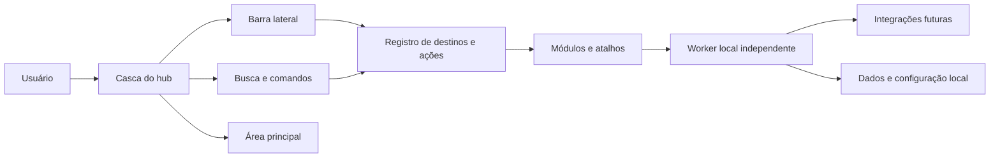

# System Design — gns-hub

Status: arquitetura inicial definida para protótipo Linux Mint · 2026-10-12

## 1. Visão e limites

O `gns-hub` será um hub pessoal para o computador do responsável. A primeira etapa reúne atalhos e funcionalidades simples. Ao longo do tempo, poderá incorporar ferramentas, integrações, automações, controles do sistema e até serviços locais. A ambição de experiência é a de um assistente pessoal no estilo “Jarvis”, sem pressupor que voz, IA ou controle do sistema façam parte da primeira versão.

**Objetivo deste documento:** dar às futuras funcionalidades e telas uma arquitetura conceitual consistente. A linguagem visual e os componentes de interface estão em [Design.md](Design.md).

A stack de trabalho e o plano de medição estão em [Technology.md](Technology.md). A execução local e as integrações estão detalhadas em [Backend.md](Backend.md); a sequência de implementação está em [Implementation Plan.md](Implementation%20Plan.md).

## 2. Escopo por horizonte

| Horizonte | Escopo | Estado |
| --- | --- | --- |
| Inicial | Casca do hub, navegação lateral, área principal, busca/comandos, worker local e estrutura para atalhos | Arquitetura definida; comandos e telas concretas em aberto |
| Evolução | Ferramentas e integrações acrescentadas de forma modular | Possibilidade, sem lista ou prioridade |
| Futuro | Configurações do computador, controles, automações, serviços locais e experiência de assistente | Possibilidade, sujeita a requisitos e permissões |

## 3. Modelo de experiência

O usuário acessa áreas pela **barra lateral** e trabalha na **área principal**. Uma **interface de busca e comandos** oferece um segundo caminho para localizar páginas e executar ações. A navegação visual e a busca devem compartilhar os mesmos nomes de destino e a mesma fonte de definição de ações, evitando duas organizações conflitantes.

O ponto de partida é desktop e notebook responsivos. A interface deve continuar utilizável em janelas menores de notebook; não há requisito confirmado para celular.

## 4. Blocos conceituais

| Bloco | Responsabilidade | Contrato esperado |
| --- | --- | --- |
| Casca da interface | Estrutura, navegação, área principal, estados globais e aplicação do design | Não conhecer detalhes internos de cada ferramenta |
| Registro de destinos e ações | Fonte única de rótulos, ícones, grupos, rotas, atalhos e comandos disponíveis | Expor identificador estável e descrição de cada item |
| Busca e comandos | Encontrar destinos e ações, mostrar contexto e confirmar operações sensíveis | Executar somente ações registradas e autorizadas |
| Módulos | Entregar funcionalidades isoladas dentro do hub | Declarar navegação, ações, estados e permissões necessários |
| Worker local | Continuar automações com a janela fechada; validar e executar ações | Processo Rust do usuário, sem porta HTTP inicial |
| Integrações | Adaptar APIs, aplicativos ou serviços externos quando surgirem | Conter autenticação, erros, limites e indisponibilidade em sua fronteira |
| Configuração pessoal | Preferências do usuário, organização dos atalhos e aparência | Dados estruturados sob domínio do worker; segredos separados |

Na primeira plataforma, a interface usa React/Vite em uma janela Tauri. O worker Rust roda como serviço `systemd --user` durante a sessão Linux e se comunica com o núcleo Tauri por socket Unix. Fechar a janela não interrompe o worker. O backend não expõe uma API HTTP local inicialmente. O detalhamento de segurança, dados e contratos fica em `Backend.md`.

## 5. Regras para expansão

1. Toda nova ferramenta deve ter propósito, nome e ações definidos antes de ganhar uma tela própria.
2. Destinos da barra lateral e comandos da busca devem derivar do mesmo registro.
3. Módulos devem usar os componentes e tokens definidos em `Design.md`.
4. Uma integração indisponível deve falhar dentro do seu módulo, com estado e mensagem claros, sem inutilizar o hub inteiro.
5. Ações que alterem o sistema, executem comandos ou acessem contas devem declarar alcance, permissão, confirmação e forma de recuperar erros antes da implementação.
6. Possibilidades futuras não entram como requisito ativo até serem escolhidas explicitamente.

## 6. Segurança e dados

O hub poderá operar ações locais e integrações pessoais. Por isso, separa **visualizar**, **navegar** e **executar**; comandos com efeito externo ou difícil reversão precisam de confirmação adequada. Segredos pertencem a armazenamento seguro do usuário, nunca ao código, ao SQLite, à configuração versionada ou à memória do projeto. SQLite embutido será a persistência estruturada inicial. Não há conta, sincronização, servidor remoto ou acesso por outros usuários na primeira versão.

## 7. Decisões pendentes antes de implementar

- Outros atalhos e ferramentas além da primeira ação de áudio, definida em [Audio Output.md](Audio%20Output.md).
- Primeira automação em segundo plano e seu gatilho.
- Primeira API e sua política de credenciais.
- Requisitos de backup/exportação e limite de RAM aceitável.
- Requisitos reais para IA, voz, acesso remoto e distribuição a outros usuários.
- Limites de permissão para operações no computador.

## 8. Critério para futuras telas

Uma tela nova deve indicar a qual módulo pertence, como aparece na navegação e na busca, seus estados vazio/carregando/erro/sucesso e as ações que oferece. Sua aparência deve seguir `Design.md`. Esta especificação evolui quando funcionalidades concretas forem escolhidas.
